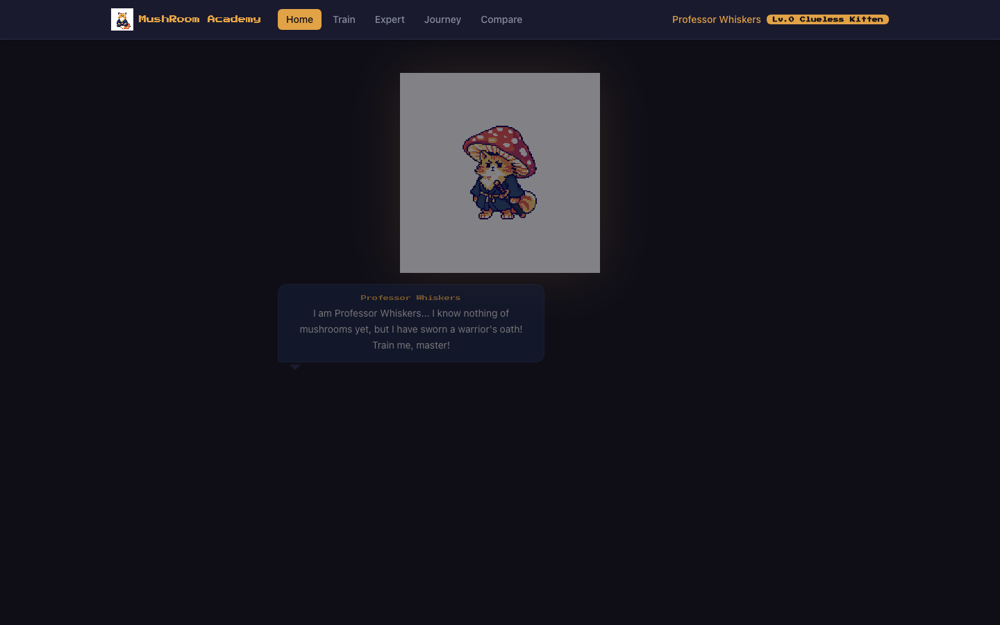
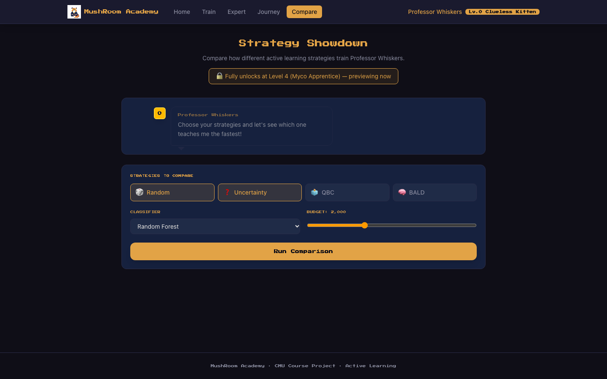
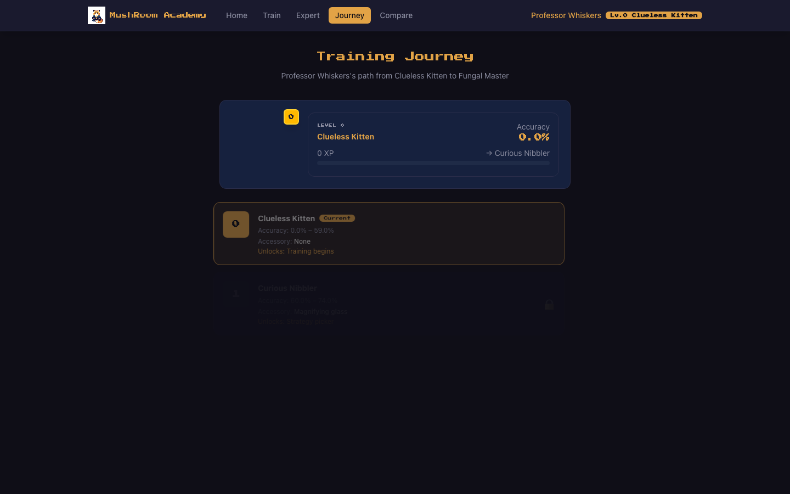
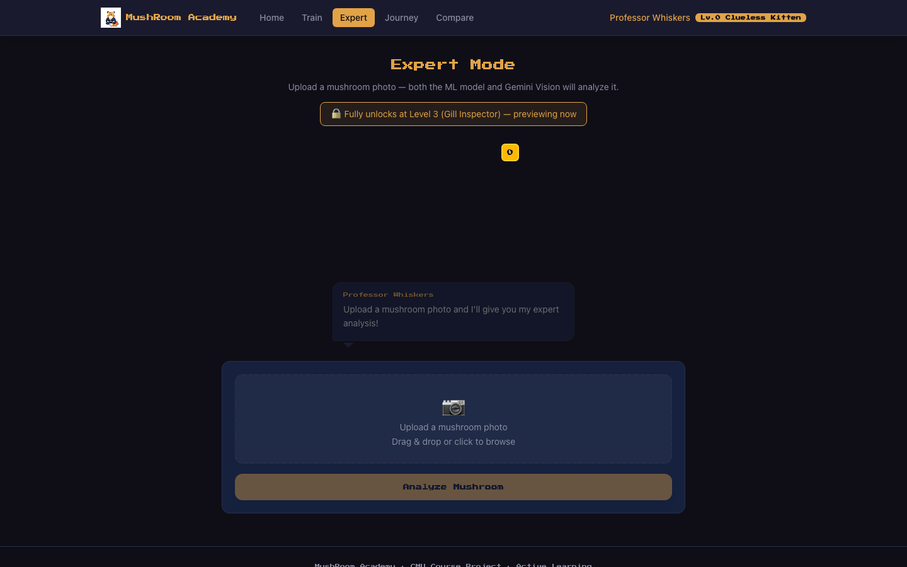

# 🍄 MushRoom Academy

A **gamified active-learning** mushroom-edibility classifier. Train your mascot
**Professor Whiskers** by labeling mushrooms, watch different active-learning
strategies race to teach him fastest, and run an **Expert Mode** where a Gemini
Vision judge and an ML classifier examine a photo side-by-side.

> ⚠️ **Research / course demo only — never eat wild mushrooms based solely on AI advice.**



---

## Overview

MushRoom Academy wraps a real active-learning research pipeline in a playful
pixel-art UI:

| Area | What it does |
|---|---|
| **Active learning** | Pick a query strategy (Uncertainty / BALD / QBC / Random) and a classifier (Random Forest / Logistic / MLP), then watch the learning curve as the model is trained on as few labels as possible |
| **Training journey** | A level/XP system — Professor Whiskers grows from *Clueless Kitten* to *Fungal Master* as accuracy climbs |
| **Strategy showdown** | Compare multiple strategies head-to-head under a fixed labeling budget |
| **Expert Mode** | Upload a photo → **Judge A** (Gemini extracts features → ML classifier) and **Judge B** (Gemini direct vision) deliver a weighted consensus verdict |

### Screenshots

| Strategy Showdown | Training Journey |
|---|---|
|  |  |
| **Expert Mode** | |
|  | |

---

## Architecture

Three independent pieces:

```
┌─────────────────────┐     HTTP /api  ┌──────────────────────┐     imports   ┌────────────────────┐
│  frontend/          │ ─────────────▶ │  backend/            │ ────────────▶ │  ml/ (mushroom_ml) │
│  React + Vite + TS  │ ◀───────────── │  FastAPI             │               │  learners,         │
│  pixel-art UI       │   JSON / WS    │  AL engine + Gemini  │               │  strategies, AL    │
└─────────────────────┘                └──────────────────────┘               └────────────────────┘
```

- **`ml/` — `mushroom_ml` package**: the pure-Python research core. Learners
  (Random Forest + probability calibration, Bagged Logistic Regression, MLP),
  query strategies, an `ALSession` active-learning loop, preprocessing, and
  evaluation. No web dependencies; unit-tested.
- **`backend/` — FastAPI service**: wraps `mushroom_ml` behind a REST/WebSocket
  API (training sessions, strategy comparison, detection) and bridges to Gemini
  Vision for Expert Mode.
- **`frontend/` — React app**: the pixel-art "MushRoom Academy" UI.

---

## Quickstart

### 1. Python environment (backend + ML)

```bash
conda env create -f environment.yml      # creates the `mushroom-project` env
conda activate mushroom-project
pip install -e ml/                        # install the mushroom_ml package (editable)
pip install -r backend/requirements.txt   # FastAPI, uvicorn, google-genai, ...
```

### 2. Gemini API key (for Expert Mode)

Create a `.env` file in the repo root:

```bash
echo 'GEMINI_API_KEY=AIza...' > .env
```

`.env` is gitignored — your key is never committed. The backend reads it via
`Settings(env_file=".env")`.

### 3. Run the backend

```bash
uvicorn backend.app.main:app --reload --port 8000
# health check: http://localhost:8000/api/health  ->  {"status":"ok"}
# API docs:     http://localhost:8000/docs
```

### 4. Run the frontend

```bash
cd frontend
npm install
npm run dev        # http://localhost:5173
```

The Vite dev server proxies `/api` and `/ws` to `localhost:8000`. In dev it also
defaults to **mock data** (`VITE_USE_MOCK`), so the UI is explorable without the
backend; set `VITE_USE_MOCK=false` to hit the real API.

---

## Project structure

```
mushroom-project/
├── ml/                          # mushroom_ml — research core (pip install -e ml/)
│   └── mushroom_ml/
│       ├── learners/            # random_forest (+calibration), logistic, mlp
│       ├── strategies/          # uncertainty, bald, committee, random
│       ├── active_learning.py   # ALSession loop
│       ├── preprocessor.py      # load/encode the tabular mushroom data
│       └── evaluation.py
├── backend/                     # FastAPI service
│   └── app/
│       ├── main.py              # app + router registration
│       ├── routers/             # training, detection, session
│       ├── services/            # al_engine, gemini_bridge
│       ├── schemas/  db/  config.py
│       └── ...
├── frontend/                    # React + Vite + TypeScript UI
│   └── src/
│       ├── pages/               # Home, Training, Expert, Journey, Comparison
│       ├── components/          # cat mascot, training arena, judge panel, ...
│       └── services/api.ts
├── data/MushroomDataset/        # tabular UCI secondary-data (training pool)
├── docs/                        # design docs, test reports, screenshots
├── environment.yml              # conda env spec
└── requirements.txt
```

---

## Active learning

The core loop: start from a tiny labeled set, repeatedly let a **strategy** pick
the most informative unlabeled instances, label them, retrain, and track the
learning curve — reaching high accuracy with far fewer labels than random.

| Strategies | Learners |
|---|---|
| Uncertainty Sampling | Random Forest (+ probability calibration) |
| BALD (Bayesian) | Bagged Logistic Regression |
| Query by Committee (QBC) | MLP |
| Random Sampling (baseline) | |

---

## Expert Mode — how the judges work

```
                 User uploads a mushroom photo
                              │
             ┌────────────────┴─────────────────┐
      ┌──────▼──────┐                     ┌──────▼──────┐
      │   Judge A   │                     │   Judge B   │
      │ Model-backed│                     │Direct Vision│
      └──────┬──────┘                     └──────┬──────┘
      Gemini extracts                     Gemini assesses
      structured features                 the photo directly
             │                                   │
      ML classifier →                     verdict + confidence
      edible/poisonous                           │
             └────────────────┬──────────────────┘
                   Weighted consensus (0.6 · A + 0.4 · B)
                              │
                        Final verdict
```

---

## Dataset

| Source | Role |
|---|---|
| `data/MushroomDataset/secondary_data.csv` | Tabular UCI mushroom instances — the active-learning training pool |
| DF20M images + embeddings (not committed — large) | Image experiments (see notebooks) |

**Target:** `class` — edible vs. poisonous. Features include cap shape/surface/color,
gill attachment/spacing/color, stem geometry, ring, spore-print color, habitat, season.

---

## Tuning knobs

| Location | Parameter | Default |
|---|---|---|
| [ml/mushroom_ml/learners/random_forest.py](ml/mushroom_ml/learners/random_forest.py) | `n_estimators` | 300 |
| [ml/mushroom_ml/learners/random_forest.py](ml/mushroom_ml/learners/random_forest.py) | `max_depth` | None |
| [backend/app/services/gemini_bridge.py](backend/app/services/gemini_bridge.py) | `DEFAULT_MODEL` | Gemini Flash |
| [backend/app/routers/detection.py](backend/app/routers/detection.py) | consensus weights | 0.6 / 0.4 |

---

## Roadmap (from proposal)

- [x] M1 — Data preprocessing
- [x] M2 — Base classifier (Random Forest + calibration)
- [x] M3 — Active learning loop (query strategies + learning curves)
- [x] M4 — Gemini Vision demo (Judge A + B)
- [x] M5 — Application UI (React + FastAPI)

---

### Note on legacy files

The repo still contains the original single-file Gradio prototype (`app.py`,
`train.py`, and the old `src/` layout). These predate the refactor into
`ml/` + `backend/` + `frontend/` and are kept only for reference — they import
modules that have since moved and will not run as-is.
